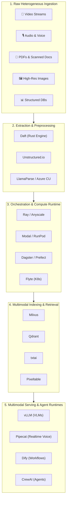

  

# 🌌 Awesome Multi-Modal Pipeline Orchestration

**A comprehensive, curated collection of SaaS platforms, serverless GPU orchestrators, and open-source frameworks for processing, chunking, indexing, and serving heterogeneous data across Video, Audio, Images, Text, and Tabular Streams at scale.**

---

## 📑 Table of Contents

- [🎯 Overview & Architecture](#-overview--architecture)
- [📊 Sector Overview & Market Dynamics](#-sector-overview--market-dynamics)
- [☁️ SaaS & Hosted Platforms](#️-saas--hosted-platforms)
- [🛠️ Open-Source GitHub Projects](#️-open-source-github-projects)
- [🧩 Multimodal Pipeline Architecture Stack](#-multimodal-pipeline-architecture-stack)
- [🤝 How to Contribute](#-how-to-contribute)
- [💖 Support & Community](#-support--community)
- [📈 Star History](#-star-history)
- [📜 Disclaimer](#-disclaimer)

---

## 🎯 Overview & Architecture

Modern AI applications have outgrown text-only LLMs. Production systems increasingly demand **Multi-Modal Pipeline Orchestration** — unified data engineering, partition, extraction, and compute workflows designed to process:
- 🎥 **Video Streams & Video Files**: Frame extraction, scene segmentation, temporal embeddings, audio-track transcription, and action recognition.
- 🎙️ **Audio & Speech**: Real-time voice agents, speech-to-text (STT), text-to-speech (TTS), semantic voice activity detection (VAD), and acoustic embeddings.
- 🖼️ **Images & Computer Vision**: Object detection, visual question answering (VQA), OCR, diagram extraction, and spatial embeddings.
- 📄 **Complex Documents & PDFs**: Structural parsing of multi-column layouts, financial tables, charts, embedded figures, and raw HTML.
- 🔢 **Structured & Time-Series Data**: Sensor telemetry, tabular metrics, and event buses correlated with unstructured visual/audio tokens.

Whether orchestrating distributed clusters with **Ray**, running low-latency voice pipelines with **Pipecat**, building asset-centric DAGs with **Dagster**, or parsing complex reports with **Unstructured** and **LlamaParse**, this guide indexes the production-grade platforms and open-source engines powering the multimodal ecosystem.

---

## 📊 Sector Overview & Market Dynamics

The global **AI Orchestration and Multimodal Data Pipeline** market is projected to expand from **$7.2 Billion in 2024 to over $38.5 Billion by 2030**, reflecting a compound annual growth rate (**CAGR**) of approximately **32.4%**. Growth is intensely accelerated by enterprise shifts toward multimodal Retrieval-Augmented Generation (RAG), visual reasoning agents, audio-first interfaces, and high-throughput vision-language models (VLMs).

The sector is currently **moderately fragmented**. While foundation data infrastructure and hyperscale computing show gravitating consolidation around data lakehouse giants (e.g., Databricks) and hyperscale cloud providers, the pipeline orchestration layer remains distinctly diversified. Workflow runtimes are split between:
1. **Serverless GPU & Python-native runtimes** (e.g., Modal, RunPod, Ray/Anyscale) optimizing for scale-to-zero compute and sub-second cold starts.
2. **Asset & lineage orchestrators** (e.g., Dagster, Prefect, Flyte) prioritizing data quality, type contracts, and reproducible DAGs.
3. **Specialized multimodal extraction engines** (e.g., Unstructured, LlamaCloud, Daft) focusing on high-accuracy document parsing, video frame tokenization, and cross-modal embedding spaces.

---

## ☁️ SaaS & Hosted Platforms

A quantitative comparison of leading hosted platforms and serverless cloud runtimes for multimodal data engineering and pipeline execution. 

*The table is sorted descending by company scale (valuation / annual recurring revenue).*

| Platform | Company Scale (Valuation / Revenue) | Starting Pricing (Specific Tiers) | Free Tier / Trial Limits | Key Capabilities & Architecture |
| :--- | :--- | :--- | :--- | :--- |
| **[Databricks](https://www.databricks.com/)** | 🏢 **$43B Valuation** (Series I) / **$2.6B+ ARR** | Standard Tier from **$0.07/DBU**; All-Purpose Compute at **$0.40–$0.55/DBU**; Serverless SQL from **$0.22/DBU** | **14-day free trial** with up to **$400 in usage credits**; Free Community/Learning Edition (1 micro-cluster, 15GB RAM, 5 concurrent tasks) | Enterprise Lakehouse platform unifying Delta Lake, Apache Spark, MLflow, distributed model training, and multimodal vector search. |
| **[Modal](https://modal.com/)** | 🦄 **$4.65B Valuation** (Series C) / **$300M+ ARR** | Serverless pay-per-second: CPU at **$0.000028/core-sec** (~$0.10/hr), T4 GPU at **$0.59/hr**, A10G at **$1.10/hr**, H100 at **$4.76/hr**; Team plan: **$250/mo** | **Free Forever Starter Plan**: **$30/month** recurring compute credits (up to 3 seats, 100 containers, 10 concurrent GPUs, 1 TiB egress) | Python-native serverless compute engine with sub-second cold starts, scale-to-zero microVMs, scheduled functions, and containerized GPU pipelines. |
| **[Ray (Anyscale)](https://www.anyscale.com/)** | 🦄 **$1.0B Valuation** (Series C) / **~$40M ARR** | Managed clusters from **$0.40/node-hr**; BYOC A100 compute at **$0.6388/hr**, H100 at **$1.86/hr**; Pay-per-token managed LLM endpoints | **$100 one-time free credits** on account creation for cluster workloads, distributed jobs, and model serving | Production managed Ray platform for large-scale distributed training, high-throughput multimodal batch inference, Ray Data, and RLlib workloads. |
| **[RunPod](https://www.runpod.io/)** | ⚡ **~$500M Valuation** (Series A) / **~$40M ARR** | Community Cloud GPUs from **$0.20/hr** (RTX 3070) & **$0.74/hr** (RTX 4090); Secure Cloud A100 from **$1.89/hr**; Serverless inference from **$0.0002/sec** | **$5–$10 promotional signup credits** for new user testing; pay-as-you-go with minimum $10 balance (no recurring free tier) | GPU cloud offering bare-metal Docker instances, serverless scale-to-zero inference endpoints, and low-cost distributed GPU clusters for custom inference. |
| **[Unstructured Pipelines](https://unstructured.io/)** | 📑 **~$250M Valuation** (Series B) / **~$15M ARR** | Serverless API at **$0.015 per page**; Vision-Language Model (VLM) enhanced extraction at **$0.02 per page** | **10,000 free processed pages** one-time trial credit upon registration (no credit card required) | Enterprise ingestion pipeline for partitioning, cleaning, and chunking complex PDFs, scanned forms, charts, and Office documents into AI-ready JSON. |
| **[Prefect Cloud](https://www.prefect.io/)** | 🔄 **~$200M Valuation** (Series B) / **~$15M ARR** | Pro Tier starting at **$39/month** (or $49/user/month); Team Tier starting at **$350/month** | **Free Forever Hobby Plan**: 2 users, 5 active deployments, **500 minutes/month** of serverless execution, 7-day run retention | Dynamic Python-native workflow orchestrator with event-driven DAGs, hybrid execution models, automated retries, and serverless worker pools. |
| **[Dagster+](https://dagster.io/)** | 📦 **~$150M Valuation** (Series B) / **~$10M ARR** | Solo plan at **$10/month** + $0.040/credit; Starter plan at **$100/month** (up to 3 users, 5 code locations, $0.035/credit); Serverless at $0.010/min | **30-day free trial** of Dagster+ with full enterprise features + 100% free open-source core with unlimited local runs | Software-defined asset (SDA) orchestration, declarative data lineage, typed data pipelines, asset health checks, and partition backfills. |
| **[Flyte (Union.ai)](https://flyte.org/)** | 🪂 **~$100M Valuation** (Series A) / **~$5M ARR** | Union Cloud Team Tier starting at **$950/month** (usage minimum credited toward execution); Serverless control plane from **$0.15/node-hr** | **30-day free trial** of Union Cloud with cluster connectivity on AWS/GCP + 100% free open-source Flyte on Kubernetes | Kubernetes-native, strongly-typed workflow orchestration with deterministic execution, caching, memoization, and massive ML scale. |
| **[LlamaCloud](https://www.llamaindex.ai/)** | 🦙 **~$100M Valuation** (Seed/Series A) / **~$5M ARR** | Pay-as-you-go starting at **$1.25 per 1,000 credits** (~$0.003/page fast, $0.0125/page agentic); Platform subscriptions from **$50/month** | **Free Forever Plan**: **10,000 credits/month** (~1,000 to 10,000 pages parsed/month), 5 concurrent jobs, 10 GB storage | End-to-end multimodal parsing (LlamaParse) for tables, charts, diagrams, and PDF/audio/video indexing into structured vector retrieval. |

---

## 🛠️ Open-Source GitHub Projects

Explore the most capable open-source tools and frameworks for multimodal ingestion, processing, vector search, and workflow execution.

*The list is strictly sorted descending by GitHub Star Count.*

- **[Dify](https://github.com/langgenius/dify)**   
  **Production-grade LLM application and visual workflow orchestrator.** Combines visual DAG design, multimodal RAG pipelines, agent capabilities, model management, and observability in a single self-hostable platform. Supports image/document processing, prompt engineering, and API deployment. Apache 2.0 licensed.

- **[LangChain](https://github.com/langchain-ai/langchain)**   
  **Industry standard framework for developing applications powered by language and multimodal models.** Features standardized multimodal message blocks (images, audio, video, documents), tool invocation, document loaders, vector store integrations, and LangGraph for cyclical agentic pipelines. MIT licensed.

- **[ComfyUI](https://github.com/comfyanonymous/ComfyUI)**   
  **Most modular, graph/pipeline-based visual execution engine for multimodal AI.** Enables declarative pipeline design for image generation, video synthesis, audio processing, and VLM inspection through node graphs. Supports custom pipelines, SDXL, Stable Video Diffusion, and arbitrary model orchestration. GPL-3.0 licensed.

- **[vLLM](https://github.com/vllm-project/vllm)**   
  **High-throughput, memory-efficient serving engine for LLMs and Vision-Language Models (VLMs).** Powered by PagedAttention with state-of-the-art serving throughput. Natively supports multi-image, video, and audio input tensors for frontier open models (LLaVA, Qwen2-VL, Pixtral, Whisper). Apache 2.0 licensed.

- **[RAGFlow](https://github.com/infiniflow/ragflow)**   
  **Open-source RAG engine based on deep document understanding.** Orchestrates end-to-end multimodal document parsing across PDFs, spreadsheets, slides, and scanned images. Extracts complex layouts, tables, and charts into structured representations with grounded citations. Apache 2.0 licensed.

- **[CrewAI](https://github.com/crewAIInc/crewAI)**   
  **Cutting-edge multi-agent orchestration framework.** Facilitates autonomous role-playing agents collaborating sequentially or hierarchically on complex multimodal workflows, research pipelines, code generation, and multi-step data transformations. MIT licensed.

- **[LlamaIndex](https://github.com/run-llama/llama_index)**   
  **Data framework for context-augmented multimodal LLM applications.** Features `MultiModalLLM` abstractions, `MultiModalVectorStoreIndex` for disjoint image/text embeddings, and `MultiModalRetriever` for cross-modal similarity search. Integrates with Chroma, Qdrant, Milvus, and Pixeltable. MIT licensed.

- **[Apache Airflow](https://github.com/apache/airflow)**   
  **De-facto industry standard batch workflow orchestration platform.** Programmatically author, schedule, and monitor robust data pipelines with Python DAGs. Connects heterogenous compute backends, data lakes, GPU clusters, and ETL transformations at enterprise scale. Apache 2.0 licensed.

- **[Milvus](https://github.com/milvus-io/milvus)**   
  **Cloud-native, highly scalable open-source vector database.** Purpose-built for massive-scale similarity search over multimodal embeddings (images, audio, video frames, text). Features GPU-accelerated indexing (Knowhere), hybrid search, and cloud-native clustering. Apache 2.0 licensed.

- **[Ray](https://github.com/ray-project/ray)**   
  **Unified open-source distributed compute framework for scaling AI and Python workloads.** Powers distributed multimodal training (Ray Train), high-throughput data processing (Ray Data), distributed serving (Ray Serve), and hyperparameter tuning (Ray Tune). Runs seamlessly on Kubernetes or cloud VMs. Apache 2.0 licensed.

- **[Qdrant](https://github.com/qdrant/qdrant)**   
  **High-performance vector search engine and similarity database written in Rust.** Provides rich payload filtering, multi-vector representations, and dense/sparse cross-modal search for multimodal RAG, recommendation systems, and visual discovery. Apache 2.0 licensed.

- **[Haystack](https://github.com/deepset-ai/haystack)**   
  **End-to-end modular LLM framework with first-class multimodal file handling.** Component-driven architecture using `FileToFileContent` to ingest audio, images, and documents into unified pipelines. Day-0 support for Gemini Embedding 2 and cross-modal embedding spaces. Apache 2.0 licensed.

- **[Prefect](https://github.com/PrefectHQ/prefect)**   
  **Python-native workflow orchestration framework.** Empowers developers with dynamic task pipelines, automatic retries, concurrency controls, background worker pools, and event-driven triggers without rigid DAG boilerplate. Apache 2.0 licensed.

- **[Pipecat](https://github.com/pipecat-ai/pipecat)**   
  **Premier open-source framework for building real-time voice and multimodal conversational AI agents.** Implements a low-latency, frame-based pipeline routing audio, video, and text across speech-to-text, LLM, and text-to-speech processors with interruption handling and semantic voice activity detection. Apache 2.0 licensed.

- **[Dagster](https://github.com/dagster-io/dagster)**   
  **Asset-centric orchestrator for machine learning, analytics, and data pipelines.** Declares software-defined assets with typed schemas, comprehensive data lineage, partition management, asset health checks, and integrated testing. Apache 2.0 licensed.

- **[Unstructured](https://github.com/Unstructured-IO/unstructured)**   
  **Foundational open-source ETL library for preprocessing raw documents.** Partitions, cleans, and chunks PDFs, scanned images, Word docs, and HTML into standardized NLP and embedding-ready structures. Apache 2.0 licensed.

- **[txtai](https://github.com/neuml/txtai)**   
  **All-in-one open-source embeddings database for semantic search, LLM orchestration, and workflows.** Unifies text, image, audio, and video vector search with transcription, captioning, translation, and autonomous multi-agent pipelines. Apache 2.0 licensed.

- **[Metaflow](https://github.com/Netflix/metaflow)**   
  **Human-centric ML and data science framework created by Netflix.** Seamlessly moves multimodal workflows from local prototype code to distributed cloud infrastructure (AWS/Azure/GCP/Kubernetes) with automatic versioning, artifact management, and dependency isolation. Apache 2.0 licensed.

- **[BentoML](https://github.com/bentoml/BentoML)**   
  **Unified model serving and pipeline orchestration framework for AI applications.** Composes multiple models into complex multimodal serving DAGs (e.g., speech-to-text + VLM + image generation) with dynamic batching, GPU management, and production packaging. Apache 2.0 licensed.

- **[Flyte](https://github.com/flyteorg/flyte)**   
  **Kubernetes-native workflow automation platform.** Provides strongly-typed task interfaces, step-level memoization/caching, deterministic reproducibility, and auto-scaling for mission-critical ML and data pipelines. Apache 2.0 licensed.

- **[ClearML](https://github.com/clearml/clearml)**   
  **Open-source MLOps suite for experiment tracking, pipeline orchestration, and model deployment.** Automatically logs multimodal dataset versions, hyperparameter runs, pipeline DAGs, and compute resource utilization. Apache 2.0 licensed.

- **[Daft](https://github.com/Eventual-Inc/Daft)**   
  **Distributed query engine and dataframe library optimized for multimodal AI workloads.** Built on Rust with an intuitive Python interface. Efficiently processes images, audio, video frames, and tabular records with built-in model transformations and direct connectors to S3, GCS, Iceberg, and Hugging Face. Apache 2.0 licensed.

- **[Beam (beta9)](https://github.com/beam-cloud/beta9)**   
  **Open-source serverless platform alternative to Modal for AI workloads.** Runs GPU inference, background task queues, and isolated code execution sandboxes with sub-second boot times, memory/filesystem snapshots, and zero vendor lock-in. Apache 2.0 licensed.

- **[Pixeltable](https://github.com/pixeltable/pixeltable)**   
  **Declarative multimodal AI data infrastructure.** Replaces ad-hoc ingestion scripts with data tables that automatically calculate embedding indices, video frame transformations, and model inferences incrementally as new raw data arrives. Apache 2.0 licensed.

- **[OpenModal](https://github.com/akhatua2/openmodal)**   
  **Deploy and manage Modal-like serverless GPU compute workloads on private cloud infrastructure.** Open-source, cloud-agnostic execution runtime for teams seeking serverless Python agility with strict data sovereignty. Apache 2.0 licensed.

- **[OmniaChain](https://github.com/RamonBritoDev/omniachain)**   
  **Async-first multimodal agent framework.** Features native support for text, PDF, image, audio, video, CSV, and code inputs with multiple model providers, native Model Context Protocol (MCP) support, and configurable supervisor/planner agent roles. MIT licensed.

---

## 🧩 Multimodal Pipeline Architecture Stack

Here is an architectural blueprint showing how these open-source and hosted tools integrate to form an end-to-end multimodal pipeline:

---

## 🤝 How to Contribute

Contributions from the developer and AI engineering community are warmly welcome! Help keep this repository comprehensive, up-to-date, and accurate:

1. **Fork the repository** on GitHub.
2. **Add or modify entries** in `README.md` maintaining consistent markdown formatting.
3. **Include essential details**:
   - For **SaaS**: Accurate pricing tiers, specific free trial / free tier limits, company valuation/revenue, and primary architectural strengths.
   - For **Open-Source**: Valid repository URL, social star badge linking to `/stargazers`, concise description, and license type.
4. **Submit a Pull Request** with a concise description of your changes.

Check out [Awesome-Awesome-Awesome](https://github.com/ishandutta2007/Awesome-Awesome-Awesome) for more curated lists!

---

## 💖 Support & Community

Thank you for exploring this curated repository! If you find this directory valuable for your research, team, or production pipelines, please consider supporting the project:

- ⭐ **Star this repository** on GitHub to help others discover it.
- 🍴 **Fork and contribute** your favorite tools, pipelines, or SaaS architectures.
- 📢 **Share with your colleagues, AI engineering communities, and networks**.
- ☕ **Sponsor the Maintainer**: If you'd like to support ongoing curation and maintenance, consider buying a coffee via the [GitHub Sponsor Dashboard](https://github.com/sponsors/ishandutta2007).

---

## 📈 Star History

---

## 📜 Disclaimer

- This is a **community-curated index** — entries do not imply commercial endorsement.
- Processing multimodal payloads (especially high-framerate video and audio streams) involves significant compute, network bandwidth, and memory overhead. Always benchmark latency, egress, and per-unit inference costs in your specific cloud environment before deploying production workloads.
- Open-source and SaaS feature sets, pricing models, and licensing terms evolve rapidly; verify current terms on the vendors' and project maintainers' official documentation.

---

  Maintained with ❤️ by <a href="https://github.com/ishandutta2007">Ishan Dutta</a> and the open-source community.

